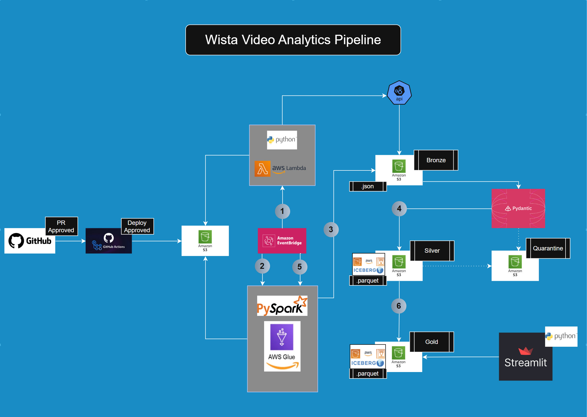

# Wistia Video Analytics Pipeline — Architecture & Design Notes

## Overview
The goal of this Medallion data pipeline is to ingest Wistia Video Analytics API data through an automated batch workflow, validate and quarantine malformed payloads, and transform the data into Apache Iceberg tables (SCD Type 1) to uncover insights into viewer engagement across videos.

---

## Medallion Layers

1. **Bronze Layer (Daily Raw Ingestion — AWS EventBridge + AWS Lambda):**
   * Triggered once daily by **Amazon EventBridge**.
   * Executes [`scripts/raw/raw_ingest.py`](scripts/raw/raw_ingest.py) in **AWS Lambda**, pulling the previous day's incremental window (`start_date` / `end_date` in `YYYY-MM-DD` format) across Wistia endpoints (`media_views`, `media_engagement`, `media_events`, `media_metadata`) with automatic pagination.
   * Uses exponential backoff with full jitter ([`scripts/raw/api_utils.py`](scripts/raw/api_utils.py)) for transient errors (`408`, `429`, `5xx`, network timeouts) and triggers **AWS SNS email alerts** via `on_giveup` ([`scripts/aws/sns_client.py`](scripts/aws/sns_client.py)) if a non-transient error occurs or retries are exhausted.
   * Writes unaltered raw JSON payloads to S3 partitioned by environment and ingestion date:
     `s3://wistia-pipeline-project/<env>/bronze/<endpoint>/year=YYYY/month=MM/day=DD/<media_id>_<timestamp>.json`

2. **Silver & Quarantine Layers (Weekly Validation & Normalization — AWS Glue + Pydantic + Apache Iceberg):**
   * Validates Bronze JSON payloads against strict **Pydantic v2** schemas ([`scripts/models/config_models.py`](scripts/models/config_models.py) & [`scripts/silver/validator.py`](scripts/silver/validator.py)).
   * **Silver Quarantine:** Any record failing Pydantic schema validation is routed with its error trace and `"layer": "silver"` metadata to `s3://wistia-pipeline-project/<env>/quarantine/silver/<endpoint>/year=YYYY/month=MM/day=DD/`.
   * **Silver Iceberg (SCD Type 1):** Valid records are flattened, deduplicated by primary key (`hashed_id`, `media_id`, or `event_key`), and merged (`MERGE INTO`) into **Apache Iceberg v2** tables in `s3://wistia-pipeline-project/<env>/silver/<endpoint>/`.

3. **Gold Layer (Weekly Dimensional & Fact Modeling — AWS Glue + Apache Iceberg):**
   * Transforms Silver Iceberg tables into analytics-ready star-schema Iceberg tables ([`scripts/gold/transformer.py`](scripts/gold/transformer.py) & [`scripts/gold/silver_to_gold.py`](scripts/gold/silver_to_gold.py)) for downstream **Streamlit** consumption:
     * `dim_media` (PK: `media_id`)
     * `dim_visitor` (PK: `visitor_id`)
     * `fact_media_engagement` (PK: `engagement_key` = `<media_id>_<date>`)
   * **Gold Quarantine:** Any record missing required Gold business keys or containing invalid numeric metrics is isolated without halting the job and routed with `"layer": "gold"` metadata to `s3://wistia-pipeline-project/<env>/quarantine/gold/<table_name>/year=YYYY/month=MM/day=DD/`.

---

## Why Bronze Runs Daily (Lambda) While Silver & Gold Run Weekly (Every 7 Days in AWS Glue)

A key architectural decision in this project balances **data freshness/auditability** against **cloud compute cost optimization**:

* **Daily Bronze Ingestion on AWS Lambda ($0 Compute Cost):**
  * Calling external REST APIs and writing raw JSON files to S3 is an I/O-bound task with a small memory footprint (`256 MB`).
  * AWS Lambda includes a perpetual **Free Tier** (1,000,000 requests and 400,000 GB-seconds per month). Running the Bronze Lambda daily captures incremental daily snapshots (`year=YYYY/month=MM/day=DD`) and daily cumulative view progressions in S3 at **$0.00/month** in compute spend.
* **Weekly (7-Day) Silver & Gold Transformations on AWS Glue (~85% Compute Cost Reduction):**
  * Unlike AWS Lambda, **AWS Glue PySpark jobs have no free tier** and bill per DPU-hour (minimum 2 `G.1X` workers) with cluster cold-start overhead on every run.
  * Because the daily Lambda job already lands each day's raw JSON cleanly into Hive-partitioned S3 folders (`year=YYYY/month=MM/day=DD`) and our data volume per day is modest, spinning up a distributed Spark cluster every single day would waste compute budget on cluster startup time.
  * By scheduling the **AWS Glue PySpark + Apache Iceberg SCD Type 1 job once every 7 days** (using Glue `FLEX` execution and combining Bronze→Silver and Silver→Gold into a single warm Spark session in [`scripts/aws/glue_spark.py`](scripts/aws/glue_spark.py)), a full week of daily Bronze partitions is validated, deduplicated, and merged into Silver and Gold Iceberg tables in a single ~90-second run—reducing AWS Glue DPU compute spend by **~85%** (to **<$0.10/month**) without losing any daily granularity.
* **Latest-Snapshot S3 Filtering for Cumulative Endpoints (`select_latest_s3_keys_per_media`):**
  * Three of the four Wistia endpoints (`media_views`, `media_engagement`, and `media_metadata`) return point-in-time lifetime cumulative totals per video (`hashed_id` / `media_id`), whereas `media_events` returns incremental daily viewer sessions (`event_key`).
  * In the **Bronze Layer**, AWS Lambda still captures all 4 endpoints daily ($0.00 Lambda compute cost and <$0.0001/month in S3 storage for ~36 KB/day of JSON), preserving a daily raw audit trail in S3 if historical progression analysis is ever needed.
  * In the **Silver Layer** ([`scripts/silver/bronze_to_silver.py`](scripts/silver/bronze_to_silver.py)), [`select_latest_s3_keys_per_media`](scripts/silver/bronze_to_silver.py) filters the S3 key list for `media_views`, `media_engagement`, and `media_metadata` before downloading so AWS Glue **only downloads and validates the single newest S3 file per `media_id`** (while still reading all daily partition files for `media_events`). This eliminates redundant S3 `GetObject` calls and Pydantic parsing over superseded snapshots, keeping Glue execution time and DPU cost minimal as the Bronze history grows over months and years.

---

## Single-Session vs. Decoupled Stage Execution (`--STAGE all | silver | gold`)

In large enterprise environments, Bronze→Silver and Silver→Gold are often split into separate Glue jobs for failure isolation and independent backfills, at the cost of paying for **two** Spark cluster cold starts and requiring an external state-machine orchestrator (such as AWS Step Functions or Glue Workflows).

To achieve **both cost efficiency and isolated stage replayability**, [`scripts/aws/glue_spark.py`](scripts/aws/glue_spark.py) supports a configurable `--STAGE` job parameter:

* `--STAGE all` *(default for weekly scheduled runs)*: Executes **Bronze → Silver → Gold** inside a **single warm Spark session**, passing validated Silver records directly into Gold and cutting AWS Glue DPU startup costs in half.
* `--STAGE silver`: Runs **only Bronze → Silver** (Pydantic validation, S3 Silver Quarantine routing, and Silver Iceberg SCD Type 1 upserts).
* `--STAGE gold`: Runs **only Silver → Gold**, reading directly from the existing `wistia_silver_<env>` Iceberg tables via [`read_silver_table_records`](scripts/gold/silver_to_gold.py) and upserting `dim_media`, `dim_visitor`, and `fact_media_engagement` (+ Gold Quarantine routing) without re-scanning raw Bronze JSON files in S3.
